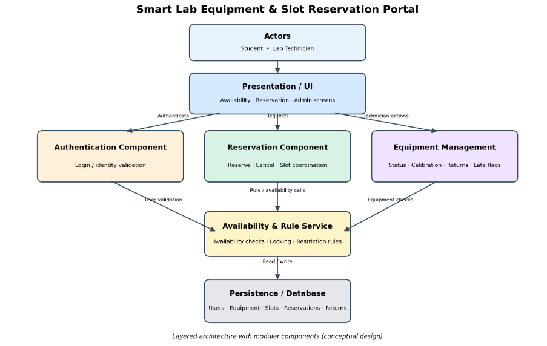

# Smart Lab Equipment & Slot Reservation Portal

## Overview

The **Smart Lab Equipment & Slot Reservation Portal** is a proposed software system designed to manage laboratory equipment availability and reservation slots. It allows students to reserve equipment and slots while enabling lab technicians to manage equipment status, calibration, returns and late-return handling.

This repository documents the proposed software architecture, component design and architectural justification.

## Architectural Style

The system follows a **Layered Architecture with Modular Components**. The architecture separates user interaction, authentication, reservation processing, equipment management, business rules and data persistence.

### Architecture Layers

- **Presentation Layer:** Provides the user interface for students and lab technicians.
- **Business / Service Layer:** Handles reservation logic, equipment rules, slot availability and validation.
- **Data Access Layer:** Manages communication between application services and the database.
- **Database Layer:** Stores users, equipment, reservations, slots and return records.

## System Components

| Component | Responsibility |
|---|---|
| Presentation / UI | Handles user interactions and displays information. |
| Authentication Component | Validates users and manages access control. |
| Reservation Component | Handles reservation creation, cancellation and booking operations. |
| Equipment Management Component | Manages equipment status, calibration, return tracking and late-return handling. |
| Availability & Rule Service | Checks slot availability and reservation constraints. |
| Persistence / Database | Stores and retrieves system information. |

## Component Architecture

The component diagram illustrates the interaction between the system components, including authentication, reservation management, equipment management, availability validation and database operations.

## Architectural Justification

Layered Architecture was selected because it provides separation of concerns, modularity and maintainability.

- **Separation of Concerns:** Each layer is responsible for a specific part of the system.
- **Maintainability:** Changes to business logic can be made without unnecessarily modifying the UI.
- **Security:** Authentication and authorization can be handled centrally.
- **Reliability:** Reservation validation and transactional operations can help prevent conflicting bookings.
- **Extensibility:** Additional equipment types and reservation rules can be added as the system evolves.

## Quality Attributes

| Quality Attribute | Design Approach |
|---|---|
| Security | Authentication and role-based access control. |
| Reliability | Reservation validation and transaction-based booking. |
| Maintainability | Modular components and separation of layers. |
| Performance | Efficient availability checks and database queries. |
| Usability | Clear availability, reservation confirmation and error messages. |
| Scalability | Modular design that can be extended with additional functionality. |

## Architecture Documentation

- [Architecture Justification](architecture-justification.pdf)
- [Component Diagram](component_diagram.png)

## Project Scope

This repository contains the architectural design and documentation for the Smart Lab Equipment & Slot Reservation Portal as part of the Software Engineering Laboratory.

The architecture represents a proposed design based on the identified system requirements and use cases.

---

**Software Engineering Laboratory – Lab 3: Component Modelling & Architectural Pattern Selection**